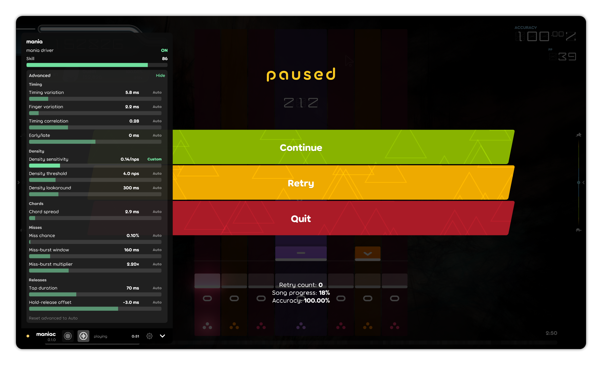

# maniac

Autoplayer for [osu!mania](https://osu.ppy.sh/wiki/en/Game_mode/osu!mania). There are two builds: one for osu!lazer (Windows, Linux, and macOS), and one for osu!stable (Windows only).

(This is a completely rewritten version of the original maniac project, which is now in the [`legacy`](https://github.com/fs-c/maniac/tree/legacy) branch.)

## Download

The latest release is on the [releases page](https://github.com/fs-c/maniac/releases/latest).

Windows may show "Windows protected your PC". That is a false positive. Click "More info", then "Run anyway".

On macOS, downloads are usually quarantined. Right-click the file and choose "Open" the first time.

### CI Builds

If you don't want to wait for a release you can also download executables from the CI which are built from the latest commit.

See the [Actions](https://github.com/fs-c/maniac/actions) tab for the latest runs, select one, and scroll down to see the produced artifacts.

## osu!lazer

1. Start osu!lazer.
2. Start maniac.
3. Open a mania map.

A panel shows up in the game. Autoplay is already on. **F8** turns it off and on, **F7** hides the panel.

You can customize the autoplay settings in the "mania" tab of the panel.

## osu!stable

Windows only. This one is a separate window, next to the game.

1. Start osu!.
2. Start the stable build (`maniac-stable`).
3. Open a mania map. (Note that you have to keep the osu!stable window focused while playing.)

Same settings & internal humanization logic as the osu!lazer version.

## Contact

[Open an issue](https://github.com/fs-c/maniac/issues), or join the [Discord](https://discord.gg/Wenkmg7).

Issues are the right place for bugs and feature requests, but please include as much detail as possible. For anything else, Discord is better. Please don't email me about maniac.

## Building

Only relevant if you want to compile it yourself.

osu!lazer has to be installed, because the project compiles against it. Windows also needs the Visual Studio C++ x64 tools (`cl.exe`). Linux and macOS need `cc`.

```
git clone https://github.com/fs-c/maniac.git
dotnet build Maniac.sln -c Release
```

If osu!lazer is not in the usual install location, add `-p:LazerDir=/path/to/osulazer`.

The osu!stable program is Windows-only:

```
dotnet build src/Maniac.Stable/Maniac.Stable.csproj -c Release
```
